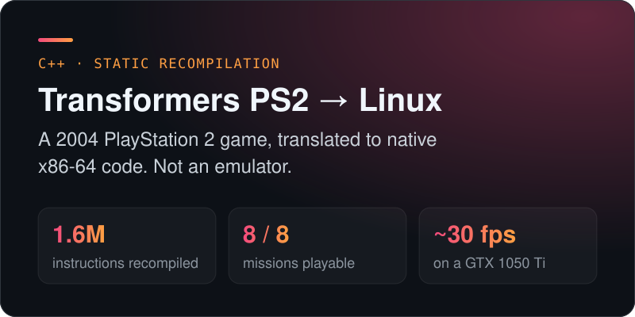
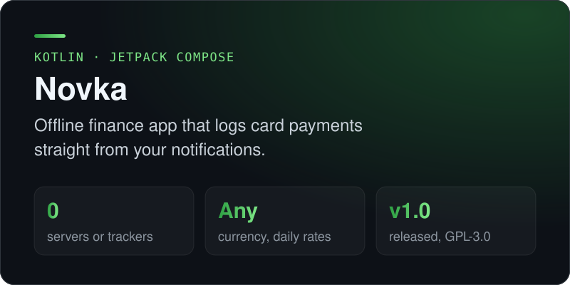
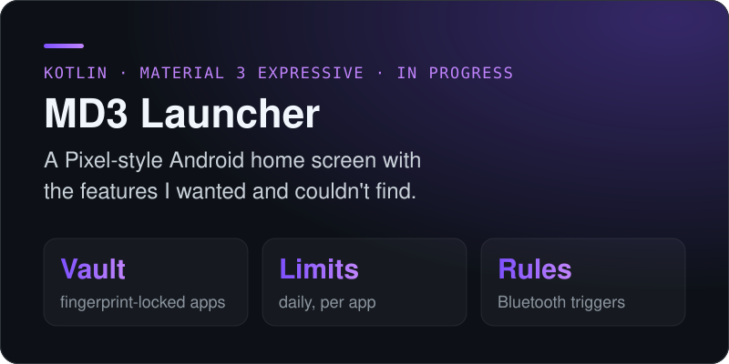
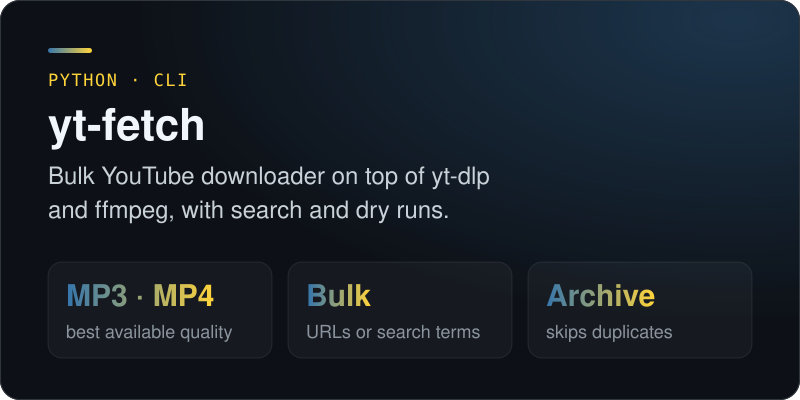

  

  
  
  

I build Android apps, websites and Python tools, and every now and then something
nobody asked for, like getting a 2004 PlayStation 2 game to run natively on Linux.

I'm based in Bosnia and Herzegovina and work remotely. Right now I'm **open to
remote roles and freelance projects**: Android apps, Next.js websites, automation
scripts and Discord bots. The best way to reach me is through
[kadraa.space](https://kadraa.space).

## Things I've built

<table>
<tr>
<td width="50%" valign="top">
  
  
The game's PS2 code is statically recompiled to native x86-64 and runs on a
  reimplementation of the PS2 hardware it uses. Ships as an AppImage with a setup
  wizard that checks your disc and builds the game for your machine.

  
  
  
  
</td>
<td width="50%" valign="top">
  
  
Reads card payments from Google Wallet and bank notifications, guesses the
  category and merges duplicates. Budgets, savings goals, password-protected backups,
  fingerprint lock and a home screen widget, all stored on the phone.

  
  
  
  
</td>
</tr>
<tr>
<td width="50%" valign="top">
  
  
A Material 3 Expressive home screen for Xiaomi phones: a hidden-app vault,
  daily app limits with a gentle overlay, notification dots, a Now Playing
  widget and saved layout snapshots. Not public yet.

  
  
  
</td>
<td width="50%" valign="top">
  
  
A command-line YouTube downloader with bulk mode, search, dry runs,
  duplicate tracking, subtitles and metadata embedding.

  
  
</td>
</tr>
</table>

<b>More: smaller tools and bots</b>

 

- [KeyPulse](https://github.com/kadraa-png/KeyPulse): an auto clicker for Linux. `Python`
- Discord bots for communities I'm part of. The repos are private, but I'm happy to show a demo. `Python`
- Websites for small businesses. `Next.js` `Tailwind`

## What I work with

  

**Android:** Kotlin, Java, Jetpack Compose, Material 3, Room, WorkManager 
**Web:** TypeScript, React, Next.js, Tailwind, Node.js 
**Scripts & bots:** Python, Bash, Discord bots 
**Lower level:** C++, CMake, OpenGL 
**Daily driver:** Arch Linux (yes, btw)

## Right now

- Finishing MD3 Launcher and getting it ready for a public release
- Working on a Windows build of the Transformers port
- Taking on freelance work. If you need an app, a website or something automated, get in touch

## Working with me

Send me a few lines about what you need through [kadraa.space](https://kadraa.space).
I'll reply with questions and a rough plan before anything starts.

  

<picture>
  <source media="(prefers-color-scheme: dark)" srcset="https://raw.githubusercontent.com/kadraa-png/kadraa-png/output/snake-dark.svg" />
  
</picture>

